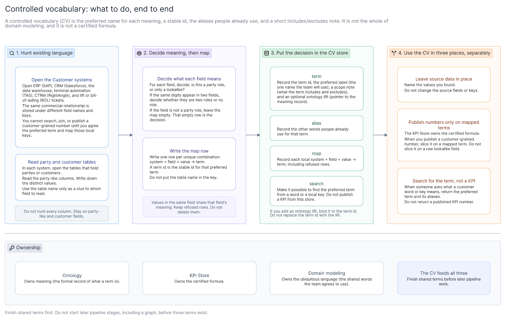

# Controlled vocabulary: the language work before an ontology

This guide says how a team agrees what its words mean before anyone builds an ontology or publishes a number. A controlled vocabulary records each meaning once, with one preferred label, a stable ID, the aliases people already use and a short scope note. It is not a taxonomy, a thesaurus, an ontology or a knowledge graph, and it does not model the business. Do the language work, then stop.

**The example is made up.** One rack lift for a company called Apex runs through every section. The company, the keys (`APEX-PAYER`, `CONS-4412`, `1000123`), the tables, the SQL names and the IRIs are invented for this guide. The KPI Store release holds none of these objects.



## How this guide meets the KPI Store

The KPI Store keeps its own vocabulary in two places.

- **The ontology.** It states the values of its code lists as SKOS concepts. A concept has a `skos:prefLabel`, and can have a `skos:definition`, a `skos:altLabel`, a `skos:scopeNote` and a `skos:notation`. These hold the preferred label, the aliases, the scope note and a short code. The concept's IRI is its stable ID.
- **The business glossary**, [`business_architecture/domain/business-glossary.md`](../business_architecture/domain/business-glossary.md). It gives each term one definition and lists the words to avoid for it.

The customer roles are in the `party` module, [`business_architecture/ontology/party/`](../business_architecture/ontology/party/). Its list of party roles in `code-lists.ttl` includes Sold-To, Payer, Bill-To and Loading-Authorized Party, which are four of the meanings the example separates. The method for the ontology itself is the `ontology` skill in `skills/ontology/`.

---

## 1. Who this is for, and the problem of one name everywhere

You are on a team that must agree what words mean before anyone builds an ontology or publishes a number. This guide is all you need for that work.

The problem is that people use the same everyday word everywhere, and it has more than one meaning.

**One lift.** A rack lift for Apex can carry, on one bill of lading:

- who the product is sold to
- who settles the invoice
- who receives the invoice
- where it lifts (the terminal)
- who is allowed to lift at the rack

A screen, a ticket or a warehouse column may call every one of those "customer". Sometimes the same digits show up in two fields. SAP `sold_to` `1000123` and SAP `bill_to` `1000123` are two roles. Warehouse `customer_id` `1000123` does not pick a role.

If you fold those into one "customer", a later number such as the unbilled amount lands on the wrong object. The vocabulary prevents that.

## 2. What a controlled vocabulary is

A controlled vocabulary is a curated, finite list of approved terms. Each meaning records four things:

1. **Preferred label.** The one approved wording (Payer, Sold-To, Bill-To, Ship-To, Loading-Authorized Party).
2. **Aliases.** The everyday variants, misspellings and system codes that map to that wording. They do not compete with it. The word `customer` can be an alias on two IDs.
3. **Scope note.** One or two lines that say what the term includes and what it excludes.
4. **`term_id`.** A stable ID (`id:payer`, `id:sold-to` and so on). Systems join on this. You may bind an IRI to it later. The IRI does not replace `term_id`.

Light usage rules, such as capitalisation and singular or plural, live next to the list. They are not a fifth label.

A controlled vocabulary does not hold local keys. `APEX-PAYER` and `CONS-4412` are in the map, not on the term row.

A controlled vocabulary does not hold the rules of the domain model. It does not decide aggregates, bounded contexts, or whether Ship-To is a place in the model. It names the meaning. Domain modeling still does the modeling, and the vocabulary is one of its tools.

A list of words with no preferred label, aliases, scope note, `term_id` and method is not a controlled vocabulary.

## Words we use

Read this once, so that the later tables are clear.

| Word | What we mean |
| --- | --- |
| **Meaning** | A distinct idea, not the word on the screen. "Customer" is one word. Sold-To and Loading-Authorized Party are two meanings of that word. |
| **Word** | The string on a screen, a ticket or a column (`customer`, `RG`, `APEX-PAYER`). One word can point at two meanings. |
| **Working group** | The people who pick the preferred label for a slice of the business (commercial, credit, rack, invoicing). The data team brings evidence. It does not name the meaning. |
| **Preferred label** | The one approved wording. People read this. |
| **Alias** | An everyday word or code that maps to a `term_id`. It does not compete with the preferred label. The same alias can be on two IDs when the word has two meanings. |
| **`term_id`** | The stable ID. Aliases and the map join on it. If the label changes later, the ID stays. |
| **Local key** | The value a system holds for a party or a place, such as `APEX-PAYER` or `1000123`. |
| **Map** | One row per system, field and local key. The row names the `term_id` that the key means in that field, or names none. The number is the party. The column is the role. |
| **Scope note** | What the meaning includes and excludes. It is not the grain of a KPI and not a formula. |
| **`ontology_iri`** | A second name for the same meaning, in an ontology file. It does not replace `term_id`. |

## 3. Purpose and scope

Decide which decisions the vocabulary must support. Name what is out of scope, so that the list does not grow without limit.

**The example supports** an agreed language for Customer in order-to-cash. With it, a later unbilled amount can be grouped on the right roles, and search can say what a word or a code means.

**Out of scope**

- Drawing an is-a tree
- Writing triples
- Publishing a certified formula
- Renaming SAP, the lift system or the warehouse in place
- Treating "unbilled" as a class of customer (unbilled is a state of an obligation)

**On the lift.** The purpose is to keep sold-to, payer, bill-to, ship-to and loading-authorized party distinct, so that "unbilled for this customer" is a question with one answer. Renaming the lift system's `CONS-4412` screen is out of scope.

## 4. Word hunt: tables, columns, values

Start where the language already is. Hunt table names, column names and the values in those columns. Also hunt tickets, screens and reports. Treat every hit as evidence of a meaning, not as an answer. Expect noise.

**Free text first.** Read ticket subjects, search logs, screen labels and report titles. People type `customer`, `lift customer`, `paying party`.

**Then structured data.** Read lookup tables, enumerations and dimension values. Extract the distinct values. Count how often each occurs. Read a sample of real rows, so that later choices rest on usage.

**On the lift, the hunt finds:**

| Where | Table or screen | Column | Value |
| --- | --- | --- | --- |
| Lift tickets | ticket row | `payer_id` | `APEX-PAYER` |
| Lift tickets | ticket row | `sold_to_id` | `APEX-HOU`, `APEX-DAL` |
| Lift tickets | ticket row | `bill_to_id` | `APEX-BILL` |
| Lift tickets | ticket row | `terminal_code` | `HSC` |
| Lift system | lift authorization | `lift_customer` | `CONS-4412` |
| SAP | partner functions | `sold_to` | `1000123` |
| SAP | partner functions | `bill_to` | `1000123` (same digits, different column) |
| Warehouse | `dim_customer` | `customer_id` | `1000123` |

The table name `dim_customer` is evidence. The column `customer_id` is evidence. The value `1000123` is evidence. None of them is the preferred label.

## 5. Cluster into meanings

Group the hits by meaning, not by the English word.

**On the lift, there are five meanings.** The names are working names until the working group approves the labels.

| Meaning | What the lift points at | What it is not |
| --- | --- | --- |
| Sold-To | Who the product is sold to (`APEX-HOU`, SAP `sold_to`) | Who pays; who may lift |
| Payer | Who settles the invoice (`APEX-PAYER`) | Sold-to; bill-to |
| Bill-To | Who receives the invoice (`APEX-BILL`) | Who pays (the two can differ) |
| Ship-To | Where it lifts (`HSC`) | A party role |
| Loading-Authorized Party | Who may lift at the rack (`CONS-4412`) | Sold-to; payer; site; the card or PIN |

Warehouse `customer_id` `1000123` does not get its own meaning. The key stands for more than one role. Record it as unresolved.

Do not fold these five into "Customer". That is the problem of one name everywhere.

## 6. Choose the preferred label

The working group picks one preferred term for each meaning. It decides from evidence, not from a count of systems:

- **Documents.** Contracts, invoices, deny codes and bills of lading show how the business already writes.
- **People.** What they search for and say.
- **Company need.** Who is harmed if the wrong word wins. Credit belongs to the payer. A denied lift belongs to the loading-authorized party. The site of an unbilled amount is the terminal.

The SAP partner-function codes (`AG` or `SP`, `RG` or `PY`) do not win. `dim_customer.customer_id` does not win.

**On the lift, the working group approved:**

| Meaning | Preferred label |
| --- | --- |
| Who the product is sold to | Sold-To |
| Who settles the invoice | Payer |
| Who receives the invoice | Bill-To |
| Where it lifts | Ship-To |
| Who may lift at the rack | Loading-Authorized Party |

Use the same spelling and hyphens everywhere. Do not adopt one system's wording because it is that system's.

## 7. Scope notes

Write one or two lines for each preferred label, with what it includes and what it excludes. A later editor and a later model must reach the same decision from the note.

**On the lift** (`cv_term.scope_note`):

| `term_id` | Scope note |
| --- | --- |
| `id:payer` | Party that settles the invoice. Not sold-to or bill-to. |
| `id:sold-to` | Party the product is sold to. Not the payer and not a lift authorization. |
| `id:bill-to` | Party that receives the invoice. Not who settles it, and not who is entitled to lift. |
| `id:ship-to` | Delivery site or terminal. Not a party role. |
| `id:loading-authorized-party` | Who may lift at the rack. Not a payer, not a sold-to, and not a site. |

A scope note does not say which terms a number may be grouped on. In the example, the unbilled amount is grouped on Payer, Sold-To and Ship-To only. Bill-To and Loading-Authorized Party have map rows and still do not group it.

## 8. Assign `term_id`

Create a stable ID for each meaning. Aliases and map rows point at it. Do not replace `term_id` with an IRI. The IRI is a later addition to the same row.

**On the lift, the IDs are:**

- `id:payer`
- `id:sold-to`
- `id:bill-to`
- `id:ship-to`
- `id:loading-authorized-party`

If the preferred label later changes from "Payer" to "Invoice payer", the ID stays `id:payer`.

## 9. Aliases

Record every variant that people and systems already use. Map each variant to exactly one `term_id`, unless the same string has two meanings. Then write two alias rows.

**On the lift,** the word `customer` is an alias on both `id:sold-to` and `id:loading-authorized-party`. Search must return both IDs. Never pick one and hide the other.

The SAP partner-function codes (`AG`, `SP`, `RG`, `PY`, `RE`, `BP`, `WE`, `SH`) are aliases, not preferred labels. `CONS-4412` is an alias of Loading-Authorized Party, and also a local key in the map. `site` is an alias of Ship-To, not another meaning of Customer.

## 10. Map local keys

The map is the agreement between the vocabulary and the systems. Each system keeps its local key. Nobody renames SAP.

Each row holds a `local_system`, a `field` and a `local_key`, and the `term_id` that the key means in that field. The `term_id` is empty when the key has no meaning the working group approved.

**The same digits in two fields make two rows.** SAP `sold_to` `1000123` maps to `id:sold-to`. SAP `bill_to` `1000123` maps to `id:bill-to`. The number is the party. The column is the role.

**Warehouse `customer_id` `1000123` has no map.** Its row has an empty `term_id` and `map_ok = no`. The warehouse dimension does not pick a role. Keep the row, because the empty row records the decision.

**On the lift, some of the rows:**

| System | Field | Local key | `term_id` | Mapped |
| --- | --- | --- | --- | --- |
| Lift tickets | `payer_id` | `APEX-PAYER` | `id:payer` | yes |
| Lift tickets | `sold_to_id` | `APEX-HOU` | `id:sold-to` | yes |
| Lift system | `lift_customer` | `CONS-4412` | `id:loading-authorized-party` | yes |
| SAP | `sold_to` | `1000123` | `id:sold-to` | yes |
| SAP | `bill_to` | `1000123` | `id:bill-to` | yes |
| Warehouse | `customer_id` | `1000123` | (empty) | no |

## 11. A short look outside

Compare your candidate terms with the language that partners already use. Take what makes a meaning clearer. Keep your own phrasing as an alias when people here use it.

**On the lift,** the SAP partner functions (sold-to, bill-to, payer, ship-to) and the header fields of a bill of lading (consignee, bill-to, ship-to) confirm the splits the hunt found. They do not become the preferred labels. Do not download a public "Customer" tree and call the hunt done. A general list has no term for who may lift at the rack.

## 12. Light governance

Before you treat the list as approved:

- **Intake** rests on evidence: frequency, a regulatory need, a company need or a confusion that someone has shown. It does not rest on opinion.
- **The working group** approves the preferred labels and scope notes.
- **Version and deprecate** terms. Change the label when you must. Keep `term_id` stable.
- **Pilot** in real work. On the lift, search `customer` and confirm that two IDs come back. Then run the unbilled amount for the Apex payer, and confirm that it is not grouped on `CONS-4412` or on warehouse `customer_id`.

A vocabulary that nobody governs grows without limit again.

## 13. What to build

Two kinds of work stay apart. The working group writes the meaning: the preferred label, the scope note, the `term_id`, the aliases, and which local keys map. The data team builds the tables and checks them. Neither does the other's part.

The example uses three tables, one search function and one warehouse table that stays as it is. The names are examples.

| Object | What it holds |
| --- | --- |
| `cv_term` | `term_id`, `preferred_label`, `scope_note`, `ontology_iri`. The join key is `term_id`. On the lift it has five rows. |
| `cv_alias` | One row per alias and `term_id`. `customer` has two rows, for `id:sold-to` and `id:loading-authorized-party`. |
| `cv_map` | `local_system`, `field`, `local_key`, `term_id`, `map_ok`, `note`. Warehouse `customer_id` `1000123` has an empty `term_id`. |
| `cv_lookup(q)` | The search. It matches `q` against an alias, a preferred label, a `term_id` or a mapped local key. It does not read `dim_customer`, returns no amount and rewrites no SQL. |
| `dim_customer` | The warehouse table with the key that stands for more than one role. One row: `customer_id = 1000123`. Nobody changes it. |

**The IRI on `cv_term`.** When an ontology exists, write each concept's IRI in `ontology_iri`. The join key stays `term_id`. These IRIs are made up:

| `term_id` | `ontology_iri` |
| --- | --- |
| `id:payer` | `https://example.org/vocabulary#Payer` |
| `id:sold-to` | `https://example.org/vocabulary#SoldTo` |
| `id:bill-to` | `https://example.org/vocabulary#BillTo` |
| `id:ship-to` | `https://example.org/vocabulary#ShipTo` |
| `id:loading-authorized-party` | `https://example.org/vocabulary#LoadingAuthorizedParty` |

Writing these IRIs does not build an ontology. It links two names for one meaning.

**Why `cv_lookup` exists.** A person or a search tool can ask "what is customer?", "what is `APEX-PAYER`?" or "what is `CONS-4412`?". The answer is a preferred label and a `term_id`. The search returns no amount and rewrites nobody's SQL.

**Three uses, kept apart**

1. **Source data stays as it is.** `SELECT customer_id FROM dim_customer` still returns `1000123`. Nothing renames a source field and nothing intercepts a query.
2. **A published KPI is grouped on mapped terms only.** The unbilled amount is grouped on keys that map to Payer, Sold-To or Ship-To. `CONS-4412` is not a payer. Warehouse `customer_id` is not a dimension of that view.
3. **Search returns a term, never an amount.** A search for `customer` returns the two IDs and no unbilled amount.

**How `cv_lookup` works.** A string that you type can be in one of three places. `customer` is an alias, on two IDs. `Payer` is a preferred label. `APEX-PAYER` is a local key in the map, not an alias. A query on `cv_term` alone misses most of them. So the function searches all three places, then joins back to `cv_term` for the label and the scope note. If two meanings match, it returns two rows. A search that hides one of them is wrong.

| Source | What it matches | `hit_kind` | Example `q` |
| --- | --- | --- | --- |
| `cv_alias` | `alias` | `alias` | `customer`, `RG` |
| `cv_term` | The preferred label or the `term_id` | `label` | `Payer`, `id:payer` |
| `cv_map` | `local_key`, where `term_id` is not null | `map_key` | `APEX-PAYER`, `CONS-4412` |

The body of the function, where `q` is the string to find:

```sql parse
SELECT DISTINCT
  t.term_id,
  t.preferred_label,
  h.hit_kind,
  h.hit_value,
  t.scope_note
FROM (
  SELECT a.term_id, 'alias' AS hit_kind, a.alias AS hit_value
  FROM cv_alias a
  WHERE lower(a.alias) = lower(q)
  UNION ALL
  SELECT term.term_id, 'label' AS hit_kind,
    CASE
      WHEN lower(term.preferred_label) = lower(q) THEN term.preferred_label
      ELSE term.term_id
    END AS hit_value
  FROM cv_term term
  WHERE lower(term.preferred_label) = lower(q)
     OR lower(term.term_id) = lower(q)
  UNION ALL
  SELECT m.term_id, 'map_key' AS hit_kind, m.local_key AS hit_value
  FROM cv_map m
  WHERE m.term_id IS NOT NULL
    AND lower(m.local_key) = lower(q)
) h
INNER JOIN cv_term t ON t.term_id = h.term_id
```

The function returns these columns:

| Column | What it is |
| --- | --- |
| `term_id` | The meaning that matched |
| `preferred_label` | The approved wording, from `cv_term` |
| `hit_kind` | How the string matched: `alias`, `label` or `map_key` |
| `hit_value` | The string that matched |
| `scope_note` | What the meaning includes and excludes, from `cv_term` |

**Keep the search and the KPIs in separate tools.** A tool that answers "what does this word mean?" reads `cv_term`, `cv_alias` and `cv_map` only. It returns a preferred label and a `term_id`. A tool that answers with amounts reads the certified KPI views only. Do not give the vocabulary tables to the KPI tool, and do not give the KPI views to the search tool.

**Checks.** These queries show what to check after you build the objects. The catalog and schema names (`my_catalog.vocabulary`, `my_catalog.sales`) and the metric view `unbilled_usd` are examples. `MEASURE()` is the Databricks function that reads a measure of a metric view.

```sql parse
SELECT term_id, preferred_label, ontology_iri
FROM my_catalog.vocabulary.cv_term
ORDER BY term_id;

SELECT * FROM my_catalog.vocabulary.cv_lookup('customer');
-- expect two IDs: id:sold-to and id:loading-authorized-party

SELECT term_id, preferred_label FROM my_catalog.vocabulary.cv_lookup('RG');
SELECT term_id, preferred_label FROM my_catalog.vocabulary.cv_lookup('APEX-PAYER');
SELECT term_id, preferred_label FROM my_catalog.vocabulary.cv_lookup('CONS-4412');

SELECT local_system, field, local_key, term_id, map_ok, note
FROM my_catalog.vocabulary.cv_map
ORDER BY local_system, field, local_key;
-- expect the warehouse key 1000123 with no term_id

SELECT payer, MEASURE(unbilled_usd)
FROM my_catalog.sales.unbilled_usd
WHERE payer = 'Apex Fuels LLC'
GROUP BY payer;
-- expect one row, grouped on the payer

-- The next two must fail: the view has no such dimension.
SELECT customer_id, MEASURE(unbilled_usd)
FROM my_catalog.sales.unbilled_usd
WHERE customer_id = '1000123'
GROUP BY customer_id;

SELECT loading_authorized_party, MEASURE(unbilled_usd)
FROM my_catalog.sales.unbilled_usd
GROUP BY loading_authorized_party;

SELECT customer_id FROM my_catalog.sales.dim_customer;
-- expect 1000123, unchanged
```

## 14. When to stop

The vocabulary for a slice of the business is finished when:

- The purpose and what is out of scope are written down
- Each meaning in scope has a preferred label, aliases, a scope note and a `term_id`
- Each local key that matters has a map row, with a `term_id` or with none
- Search returns both IDs for a word with two meanings
- Published numbers are grouped on mapped terms only
- Intake, approval, versions and deprecation each have an owner

Then stop.

Do not draw the is-a tree. Do not write a thesaurus of related terms. Do not declare classes beyond the IRI already on `cv_term`. Do not build a knowledge graph.

The later work (metadata standards, taxonomy, thesaurus, ontology, knowledge graph) uses this language. It also inherits every ambiguity you leave in it.

On the lift, you stop when four things are true. Sold-To, Payer, Bill-To, Ship-To and Loading-Authorized Party are distinct. `customer` returns two IDs. Warehouse `1000123` has no map. The unbilled amount for the Apex payer is grouped on the payer.

## The steps in short

1. Write the purpose and what is out of scope.
2. Hunt table names, column names and values, and also tickets, screens and reports. Treat each hit as evidence.
3. Cluster by meaning. Do not fold Sold-To, Payer, Bill-To, Ship-To and Loading-Authorized Party into "Customer".
4. Have the working group pick the preferred labels and scope notes. The data does not name the meaning.
5. Assign each `term_id`. Record the aliases. Write the map with one row per system, field and local key. The same digits in two fields make two rows. A warehouse key with no role gets an empty row.
6. Build `cv_term`, `cv_alias`, `cv_map` and `cv_lookup`. Leave `dim_customer` as it is.
7. Keep the three uses apart. Source data stays as it is, published KPIs are grouped on mapped terms only, and search never returns an amount.
8. Write `ontology_iri` when the ontology exists. Do not replace `term_id`.
9. Stop. Do not draw a class tree. Domain modeling does the rest.
